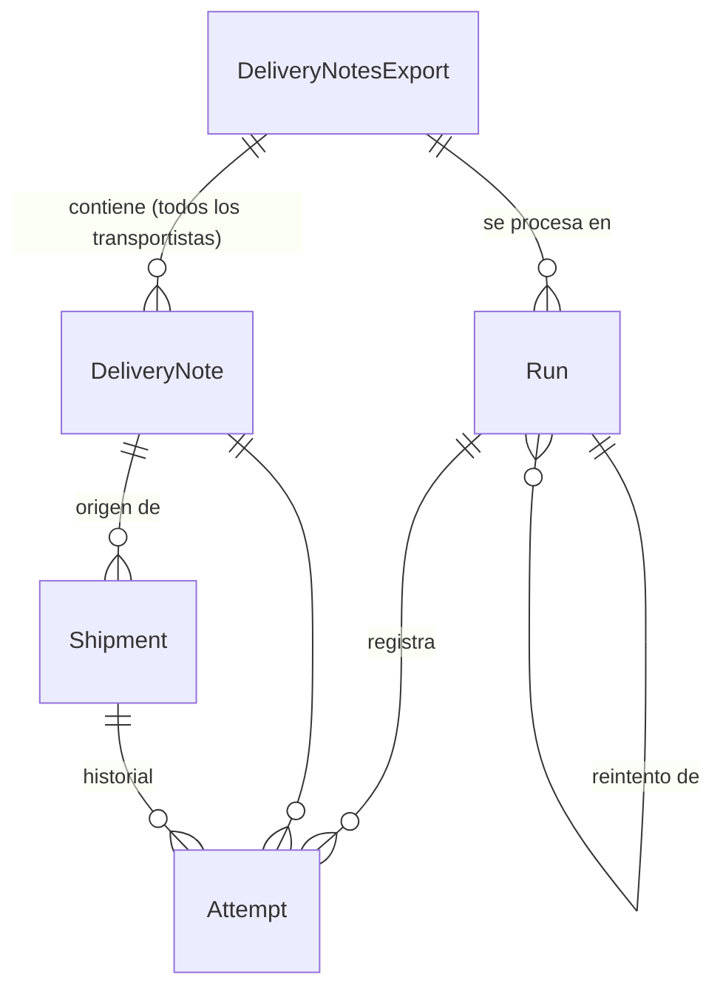

# Solución: de los remitos de LogiSur a la API del transportista

Este documento explica cómo el backend toma la exportación diaria de remitos de LogiSur y la carga en la API de envíos del transportista (hoy, Expreso Andino). Cubre:
- qué hace cada paso;
- qué se guarda y cuándo;
- cómo se informa cada error en términos de negocio;
- cómo se reintenta sin duplicar envíos;
- qué cambiaría en un producto real.

Los valores que se guardan (estados, pasos, códigos de motivo) y los mensajes que ve el usuario están en **inglés**. Este documento los explica, pero no los traduce.

Decisión técnica de referencia: [ADR 0005](docs/adr/0005-functional-pipeline-persistence-and-idempotent-delivery.md).

## Resumen

```
POST /exports (archivo)        POST /runs { exportId }
        │                               │
        ▼                               ▼
     UPLOAD ──► NORMALIZE ──► FILTER ──► VALIDATE ──► MAP ──► DELIVER
     carga      normaliza     filtra     valida       mapea   envía a la API
```

- **Subir una exportación y correrla son dos recursos separados.** `POST /exports` guarda el archivo y todos sus remitos. `POST /runs` crea una corrida (`run`) que procesa esa exportación para el transportista configurado.
- **Una corrida informa qué pasó:** totales, y un desglose por resultado, paso y motivo, en términos de negocio. El detalle de cada remito se consulta en `GET /attempts`.
- **Todo queda en PostgreSQL y se puede consultar, paginado y con filtros:** exportaciones, remitos, corridas, intentos y envíos.
- **Todo envío fallido se puede reintentar.** El reintento retoma desde el paso que falló, sin repetir los anteriores.
- **Ningún remito se envía dos veces,** aunque se reintente, se vuelva a correr la misma exportación o la API falle a mitad de camino.

## API

Todo listado es paginado por cursor (`?after=<último id>&limit=20`, máximo 100) y devuelve `{ items, nextCursor }`. Los ids van siempre en la URL del recurso al que pertenecen.

| Método y ruta | Qué hace | Filtros |
| --- | --- | --- |
| `POST /exports` | Sube una exportación (multipart, campo `file`). `201` con `{ id, uploadedAt, deliveryNoteCount }`. | — |
| `GET /exports` | Lista exportaciones, la más nueva primero. | `uploadedFrom`, `uploadedTo` |
| `GET /exports/:id` | Una exportación. | — |
| `GET /exports/:id/content` | El archivo, tal cual se subió. | — |
| `GET /delivery-notes` | Lista remitos, tal cual se exportaron. | `exportId`, `number`, `carrier` |
| `GET /delivery-notes/:id` | Un remito. | — |
| `POST /runs` | Corre una exportación: `{ "exportId": "…" }`. `201` con la corrida. | — |
| `POST /runs/:id/retries` | Nueva corrida con los envíos que fallaron en la corrida `:id`. | — |
| `GET /runs` | Lista corridas. | `status`, `kind`, `exportId`, `carrier` |
| `GET /runs/:id` | Una corrida: totales y desglose. | — |
| `GET /attempts` | Qué le pasó a cada remito en cada corrida. | `runId`, `shipmentId`, `outcome`, `step`, `reasonCode`, `deliveryNoteNumber` |
| `GET /shipments` | Lista envíos. | `status`, `carrier`, `deliveryNoteNumber`, `failedStep`, `reasonCode` |
| `GET /shipments/:id` | Un envío, con la salida de cada paso. | — |
| `POST /shipments/:id/retries` | Nueva corrida que retoma ese envío fallido. | — |

Errores:
- `400` para datos de entrada inválidos.
- `404` si el recurso no existe.
- `409` si no hay nada para reintentar, o el envío no está fallido.
- `413` si el archivo supera 5 MB.
- `422` si el archivo no es una exportación legible.

```bash
docker compose up --build          # postgres :5432, API mock :8000, backend :3000, frontend :8080

EXPORT=$(curl -s -F file=@data/remitos_2026-09-30.json localhost:3000/exports | jq -r .id)
RUN=$(curl -s -H 'Content-Type: application/json' -d "{\"exportId\":\"$EXPORT\"}" localhost:3000/runs | jq -r .id)
curl "localhost:3000/runs/$RUN"
curl "localhost:3000/attempts?runId=$RUN&outcome=FAILED"
curl -X POST "localhost:3000/runs/$RUN/retries"
```

Con la exportación de ejemplo y el mock recién iniciado, la corrida termina así:
- **51 remitos en total.**
- **20 enviados.**
- **3 fallidos:** sin código postal, dirección en blanco y 0 bultos.
- **28 omitidos:** 19 de otros transportistas, 8 que retira el cliente y 1 duplicado.

Si se vuelve a correr, los mismos 20 cuentan como **enviados** (el sistema ya los tiene) y no se envía nada de nuevo.

## Organización del código

El backend está organizado por funcionalidad, en `backend/src/modules/`: **un paquete por recurso REST**, con todas sus operaciones (`POST`, `GET`, ...) juntas. Cada paquete tiene su controlador, servicio, repositorio, mapper y DTOs, todos con el nombre del paquete (`runs.controller.ts`, `runs.service.ts`, ...), y solo los repositorios hablan con la base.

| Paquete | Qué hace |
| --- | --- |
| `exports` | `/exports`: sube, guarda y lee las exportaciones. Contiene el lector (`reader/`) y el almacenamiento (`storage/`). |
| `delivery-notes` | `/delivery-notes`: los remitos de cada exportación. Solo el modelo de dominio del remito: los tipos (`types/`) y los esquemas Zod de sus campos (`schemas/`). |
| `runs` | `/runs`: crea corridas (ejecuta el pipeline sobre una exportación, y los reintentos), las lista y las lee con su desglose. Contiene el pipeline (`pipeline/`) y guarda el avance de cada envío. |
| `attempts` | `/attempts`: qué le pasó a cada remito en cada corrida (solo lectura; los registra `runs`). |
| `shipments` | Consulta de envíos, y su reintento (que delega en `runs`). |
| `carriers` | Registro de transportistas, contrato del cliente y router. |

Las dependencias van en un solo sentido:
- `shipments` usa `runs`.
- `runs` usa `exports`, `delivery-notes` y `carriers`.
- `exports` usa `delivery-notes` (al subir, guarda sus remitos).
- `attempts` no depende de otros paquetes.

## El pipeline, paso a paso

El pipeline no es un servicio: es una **composición de piezas chicas, cada una con un solo trabajo**. `delivery-notes.pipeline.ts` dice qué pieza hace cada paso y en qué orden:

| Paso | Pieza | Qué hace |
| --- | --- | --- |
| UPLOAD | `ExportsService.upload` | Lee el archivo (array JSON de objetos, UTF-8) y guarda la exportación y **todos** sus remitos, de todos los transportistas, tal cual vinieron. Si no se puede leer: `422` y **no se guarda nada**. |
| NORMALIZE | `normalizer/` | Lee cada campo con su parser: texto, entero, decimal (`"145,1"` → 145.1), provincia (`Bs. As.` → Buenos Aires), servicio, transportista. Nunca falla y no adivina. |
| FILTER | `filter/` | Filtros componibles (ver abajo). |
| VALIDATE | `validator/` | Reglas de lo que exige el transportista. Informa **todos** los problemas juntos. |
| MAP | `mapper/` | Al formato de la API del transportista (lo define su integración). |
| DELIVER | `deliverer/` | Envío idempotente (ver "Idempotencia"). |

- **Las piezas son funciones puras:** no son módulos de Nest, no tienen controlador y no hacen I/O por su cuenta.
- **VALIDATE, MAP y DELIVER son *etapas* (`Stage`):** `{ paso, run(entrada) → Result }`. `runStages` las ejecuta en orden desde cualquier paso, y avisa después de cada una para que se guarde su salida. Así un reintento retoma donde quedó.
- **`RunsService` ejecuta el pipeline:** lo arma, lo corre y guarda cada paso a través de los repositorios. No contiene reglas de negocio.

### Tipos estrictos, tablas y Zod

- **Cada campo normalizado es un `Field<T>`:** `VALID` con su valor, `MISSING`, o `INVALID` con el texto original. No hay `null` ni `unknown` en los tipos del pipeline ni en lo que se guarda. El remito original se tipa como JSON.
- **Los parsers son esquemas Zod** (`schemas/delivery-note.schemas.ts`):
  - uniones para texto o número;
  - expresiones regulares para enteros y decimales;
  - **listas blancas** para provincias, servicios y transportistas (`lookup(tabla)`). Se compara sin mayúsculas, acentos ni puntos.
- **La validación es un esquema Zod** cuyos mensajes son los códigos de motivo. Cada regla está en una línea, por ejemplo `packages: z.number(...).min(MIN_PACKAGES, { error: TOO_FEW_PACKAGES })`.
- **Los motivos y sus mensajes** están en un solo catálogo (`pipeline/reasons.ts`). Los límites son constantes con nombre (`MIN_PACKAGES`, `MIN_WEIGHT_KG`).
- **Las respuestas de la API del transportista también se validan con Zod.** Los códigos HTTP, los campos de la API y los servicios se traducen con tablas.

### Por qué normalizar, luego filtrar, luego validar

LogiSur es dueño de todos sus remitos, sea cual sea el transportista. Por eso se guardan todos en UPLOAD, y la normalización (que no depende del transportista) se aplica a todos. La **validación sí depende del transportista**: valida lo que exige su API. Por eso se valida después de filtrar. Un remito roto de Cruz del Norte no aparece como fallido en una corrida de Expreso Andino: se informa como "Assigned to another carrier".

### Filtros componibles

Un filtro es una función `candidatos → { kept, decided }`. `composeFilters` los aplica de izquierda a derecha, y cada uno solo ve lo que dejaron pasar los anteriores. Para reordenarlos o agregar uno, se cambia un solo lugar (`deliveryNotesPipeline`):

```ts
const filter = composeFilters(
  byCarrier(config.carrier),              // solo el transportista de la corrida
  hasNumber(),                            // sin número no hay referencia para el transportista
  dedupeWithinExport(),                   // repetidos en la exportación
  alreadyDelivered(config.delivered),     // ya enviados en corridas anteriores
);
```

| Filtro | Decide | Cómo |
| --- | --- | --- |
| `byCarrier` | Otro transportista: omitido (`OTHER_CARRIER`). Retira el cliente: omitido (`CUSTOMER_PICKUP`). Sin transportista o desconocido: fallido (`MISSING_CARRIER`, `UNKNOWN_CARRIER`). | Tabla de decisiones |
| `hasNumber` | Sin número de remito: fallido (`MISSING_DELIVERY_NOTE_NUMBER`). | — |
| `dedupeWithinExport` | Copias idénticas: se envía una sola vez y el resto se omite (`DUPLICATE_IN_EXPORT`). Mismo número con datos distintos: todas fallan (`CONFLICTING_DUPLICATE`). | — |
| `alreadyDelivered` | Ya enviado con los mismos datos: **enviado** (idempotente). Con datos distintos: fallido (`DELIVERED_WITH_DIFFERENT_DATA`). | Hash del remito normalizado |

El orden importa, y los tests lo muestran. Si `dedupeWithinExport` va primero, un duplicado conflictivo de otro transportista falla. Si `byCarrier` va primero, ese mismo remito simplemente se omite.

## Qué se guarda y cuándo

- **Nada roto:** si el archivo no es legible, no se guarda nada (`422`).
- **En la carga:** la exportación (bytes originales) y un `DeliveryNote` por remito (JSON original, número y transportista para consultar).
- **Después de cada paso,** el envío (`Shipment`) se actualiza con la salida de ese paso:
  - el remito normalizado y su hash;
  - el pedido mapeado;
  - el tracking id;
  - `lastCompletedStep`;
  - si falla, `failedStep` y el motivo.
- **Por cada remito y corrida** se guarda un intento (`Attempt`), con estos datos:
  - desde qué paso arrancó y hasta cuál llegó;
  - el resultado (`DELIVERED`, `SKIPPED` o `FAILED`);
  - el motivo en términos de negocio;
  - todos los problemas encontrados;
  - el tracking id;
  - el detalle técnico.



| Tabla | Qué es | Claves |
| --- | --- | --- |
| `delivery_notes_exports` | El archivo subido, byte a byte. | `id` |
| `delivery_notes` | Cada remito, tal cual vino. | único (`export_id`, `position`); índices por `number` y `carrier` |
| `runs` | Una ejecución: `INITIAL` o `RETRY` (con `parent_run_id`). Estado y totales. | índices por `export_id`, `status` |
| `shipments` | Un remito en camino a un transportista, con la salida de cada paso. | **único (`carrier`, `external_ref`)** = la clave de idempotencia del transportista |
| `attempts` | Qué le pasó a un remito en una corrida. | índices por (`run_id`, `outcome`), `shipment_id`, `reason_code` |

## Corrida e intentos

`GET /runs/:id` (y la respuesta de `POST /runs` y de los reintentos):

```json
{
  "id": "…", "kind": "INITIAL", "status": "COMPLETED_WITH_FAILURES",
  "carrier": "EXPRESO_ANDINO", "carrierName": "Expreso Andino",
  "totals": { "total": 51, "delivered": 20, "failed": 3, "skipped": 28 },
  "breakdown": [
    { "outcome": "DELIVERED", "step": "DELIVER", "count": 20 },
    { "outcome": "FAILED", "step": "VALIDATE", "reasonCode": "MISSING_POSTAL_CODE", "count": 1 },
    { "outcome": "SKIPPED", "step": "FILTER", "reasonCode": "OTHER_CARRIER", "count": 19 }
  ]
}
```

`GET /attempts?runId=…&outcome=FAILED` da el detalle por remito: número, paso, código, mensaje, problemas y si se puede reintentar (`retryable`).

```json
{ "deliveryNoteNumber": "R-10000477", "reachedStep": "VALIDATE", "outcome": "FAILED",
  "reasonCode": "MISSING_POSTAL_CODE", "reason": "Postal code is missing", "retryable": true }
```

Estados de una corrida: `RUNNING`, `COMPLETED`, `COMPLETED_WITH_FAILURES` y `FAILED`, este último cuando la corrida se interrumpió por un error inesperado.

## Catálogo de motivos

| Código | Paso | Resultado | Mensaje (ejemplo) | ¿Sirve reintentar? |
| --- | --- | --- | --- | --- |
| `OTHER_CARRIER` | FILTER | omitido | Assigned to another carrier (Cruz del Norte) | — |
| `CUSTOMER_PICKUP` | FILTER | omitido | Picked up by the customer; nothing to ship | — |
| `DUPLICATE_IN_EXPORT` | FILTER | omitido | Delivery note R-… appears 2 times in the export with the same data; it is sent once | — |
| `IN_PROGRESS_ELSEWHERE` | FILTER | omitido | Already being processed by another run | — |
| `MISSING_CARRIER` / `UNKNOWN_CARRIER` | FILTER | fallido | Unrecognized carrier "…"; check the delivery note | Corregir y volver a subir |
| `MISSING_DELIVERY_NOTE_NUMBER` | FILTER | fallido | The delivery note has no number | Corregir y volver a subir |
| `CONFLICTING_DUPLICATE` | FILTER | fallido | … appears 2 times in the export with different data … | Corregir y volver a subir |
| `DELIVERED_WITH_DIFFERENT_DATA` | FILTER | fallido | Already delivered …, but this export has different data | Corregir con el transportista |
| `MISSING_*` (destinatario, dirección, ciudad, provincia, código postal, bultos, peso, servicio) | VALIDATE | fallido | Postal code is missing | Corregir y volver a subir |
| `UNKNOWN_PROVINCE`, `INVALID_PACKAGES`, `INVALID_WEIGHT`, `INVALID_DECLARED_VALUE`, `UNKNOWN_SERVICE` | VALIDATE | fallido | Number of packages "dos" is not a whole number | Corregir y volver a subir |
| `TOO_FEW_PACKAGES`, `NON_POSITIVE_WEIGHT`, `NEGATIVE_DECLARED_VALUE` | VALIDATE | fallido | Must have at least 1 package (has 0) | Corregir y volver a subir |
| `PROVINCE_NOT_SERVED` | VALIDATE | fallido | The carrier doesn't deliver to … | Si el transportista amplía cobertura |
| `NO_CARRIER_INTEGRATION` | VALIDATE | fallido | There is no integration to deliver to … yet | Sí, cuando exista la integración |
| `REJECTED_BY_CARRIER` | DELIVER | fallido | The carrier rejected the shipment (postal code: …) | Corregir los datos |
| `CARRIER_UNAVAILABLE` | VALIDATE / DELIVER | fallido | The carrier's service is not responding; retry later | **Sí** |
| `INVALID_CARRIER_CREDENTIALS` | VALIDATE / DELIVER | fallido | The carrier refused our credentials; … | Sí, después de corregir la configuración |
| `INTERNAL_ERROR` | cualquiera | fallido | Unexpected error while processing; retry it … | Sí |

`retryable` dice si el envío **se puede** reintentar ahora (sigue en estado `FAILED`). Los fallos de filtrado no tienen envío: se resuelven corrigiendo la exportación.

## Idempotencia y reintentos

### Qué dice la API (`expreso-api/API.md`)

- `external_ref` es **único**: el transportista nunca guarda dos envíos con la misma referencia. Usamos `nro_remito` como `external_ref`.
- `201` creado.
- `409 duplicate`: ya existía, y la respuesta trae su `tracking_id`.
- `422`: datos inválidos, con el detalle por campo.
- `500` / `503`: se recomienda reintentar. **Un `500` no garantiza que el envío no se haya creado.**
- `GET /v1/shipments?external_ref=` busca un envío por referencia.

### Cómo lo usamos (genérico: nunca depende de referencias puntuales)

**"Ya existía" no es un caso aparte.** Si el transportista ya tenía el envío, el resultado es el mismo que si se hubiera creado ahora: `DELIVERED` con su tracking id. Eso es lo que significa que sea idempotente.

1. **Nuestra base primero.** Si (transportista, remito) ya está `DELIVERED` con los mismos datos, cuenta como enviado sin llamar a la API. Si llega con datos distintos (el hash del remito normalizado no coincide), se informa en lugar de enviarse.
2. **Reclamo atómico.** Antes de procesar un envío se lo pasa a `PROCESSING` con un `UPDATE … WHERE status IN (PENDING, FAILED)`. Si dos reintentos llegan a la vez, solo uno lo procesa.
3. **Envío:**
   - `201` o `409`: enviado, con el tracking.
   - `422`: fallido, sin reintentar. Los campos de la API se traducen a los nuestros.
   - `401`: fallido, y la corrida deja de llamar al transportista.
4. **Fallo ambiguo** (`500`, `503`, timeout, error de red): antes de volver a enviar se **busca por `external_ref`**. Si el envío existe, se toma ese. Si no, se reenvía. Si la búsqueda también falla, ese intento termina sin reenviar a ciegas.
5. **Reintentos automáticos** con backoff exponencial: hasta 4 intentos con `RetryPolicy` de `@nestjs/resilience`. Si se agotan, el envío queda `CARRIER_UNAVAILABLE` y se puede reintentar a mano.

Verificado contra el mock: después de una corrida, cada remito enviado existe **exactamente una vez** en el transportista, con el mismo tracking. Volver a correr la exportación no envía nada.

### Reintentos manuales: retoman desde donde quedó

`POST /runs/:id/retries` (los fallidos de esa corrida) o `POST /shipments/:id/retries` (uno) crean una corrida `RETRY`. Por cada envío:
- **Si falló en DELIVER:** se reenvía **el pedido guardado**. No se normaliza, valida ni mapea de nuevo.
- **Si falló antes:** se vuelve a validar el remito normalizado que quedó guardado, porque las provincias o las reglas pueden haber cambiado, y se continúa.

Para **corregir datos** (por ejemplo, el código postal que falta) se sube una exportación corregida y se corre: el envío de ese remito se procesa de nuevo con los datos nuevos.

## Transportista configurable

- **No hay nada atado a Expreso Andino** fuera de su integración (`backend/src/integrations/expreso-andino/`):
  - el registro de transportistas (`carriers/carrier-registry.ts`) es una tabla con todos los de la exportación y sus formas de escribirse;
  - los filtros reciben el transportista como parámetro.
- **El transportista de cada despliegue se configura** con `CARRIER` (por defecto `EXPRESO_ANDINO`), validado al arrancar con un esquema Zod.
- **El pipeline llega al transportista a través del `CarrierRouter`.** Le pide el cliente del transportista (`CarrierClient`: `provinces`, `toShipmentRequest`, `deliver`) y nunca importa una integración directamente.
- **Con otro transportista configurado,** sus remitos se filtran y validan igual, y fallan como `NO_CARRIER_INTEGRATION`, listos para reintentar cuando exista la integración.

## Decisiones de alcance

- **Procesamiento síncrono.** `POST /runs` procesa la exportación completa antes de responder. Hace el sistema simple de probar de punta a punta: un request, un resultado. **Se descartó lo asíncrono por tiempo y por la complejidad de testearlo** (workers, colas y esperas en los tests).
- **Una corrida por vez y por transportista,** según la configuración.
- **Provincias para normalizar:** una lista blanca fija de las 24 jurisdicciones con sus abreviaturas. La validación usa la lista real del transportista.

### Limitaciones conocidas

- **Si el proceso se cae a mitad de una corrida,** los envíos que estaban en `PROCESSING` quedan así y no se pueden reintentar por la API. La corrida queda `RUNNING` o `FAILED`. En producción, un job periódico los devolvería a `FAILED`.
- **Un request largo puede cortarse por timeout** de un proxy si la exportación es grande o el transportista está lento, porque cada envío puede esperar sus reintentos. Es la razón principal para pasar a asíncrono.

## Hoja de ruta para un producto real

### Procesamiento asíncrono en cola

- **`POST /runs` crearía la corrida y respondería `202`.** La interfaz consulta `GET /runs/:id` o recibe eventos (SSE o websockets) mientras avanza.
- **Cola:**
  - Una cola en **Redis con BullMQ** (`@nestjs/bullmq`), con un job por corrida o por envío.
  - Workers separados del API, con concurrencia limitada por transportista (para respetar su capacidad).
  - Reintentos con backoff y una dead-letter queue para lo que no se recupera.
- **Jobs nocturnos** (`@nestjs/schedule` más `@nestjs/locks` para que corran en una sola instancia):
  - tomar la exportación del día cuando LogiSur la deja disponible (carpeta compartida, SFTP o bucket);
  - correrla de madrugada, para que los remitos estén cargados y el informe listo a primera hora;
  - reintentar los fallos transitorios fuera de horario.
- **Recuperación:** un job periódico libera los envíos en `PROCESSING` cuyo worker murió y los deja `FAILED` con un motivo, para reintentarlos.
- **Outbox** (`@nestjs/outbox`) para publicar los eventos de cambio de estado sin perder ninguno.
- **El diseño actual ya lo permite.** Cada paso es una función pura y el estado de cada envío se guarda después de cada paso. Un worker haría exactamente lo mismo que hoy hace `RunsService`, sin cambiar las piezas del pipeline.

### Multi-transportista

- **Modelos nuevos:**
  - `carriers`: cada transportista con sus alias y su integración, y si está activo.
  - `clients`: los clientes de LogiSur y sus credenciales por transportista, si cada cliente tiene su propia cuenta.
  - Los envíos ya están identificados por (transportista, remito).
- **El router enviaría cada envío al cliente de su transportista,** y una corrida podría procesar varios transportistas a la vez. `CARRIER` dejaría de ser configuración y pasaría a ser un dato de la corrida o del remito.
- **Validación por transportista:** cada integración aportaría sus reglas (por ejemplo, si exige código postal).
- **Seguimiento:** consultar el estado de cada envío (`GET /v1/shipments/{tracking_id}`: `CREATED`, `IN_TRANSIT`, `DELIVERED`, `EXCEPTION`) con un job periódico y mostrarlo junto al remito.
- **Selección de transportista con insights:**
  - tasa de éxito, rechazos y tiempos de entrega por transportista, provincia y servicio;
  - costo por envío;
  - recomendaciones de qué transportista conviene para cada remito.

### Otros

- Corrección de datos desde la interfaz (editar un remito fallido y reintentar), con auditoría.
- Autenticación y permisos (`@nestjs/authentication` y `@nestjs/authorization`), y alertas cuando una corrida termina con fallos o el transportista está caído.
